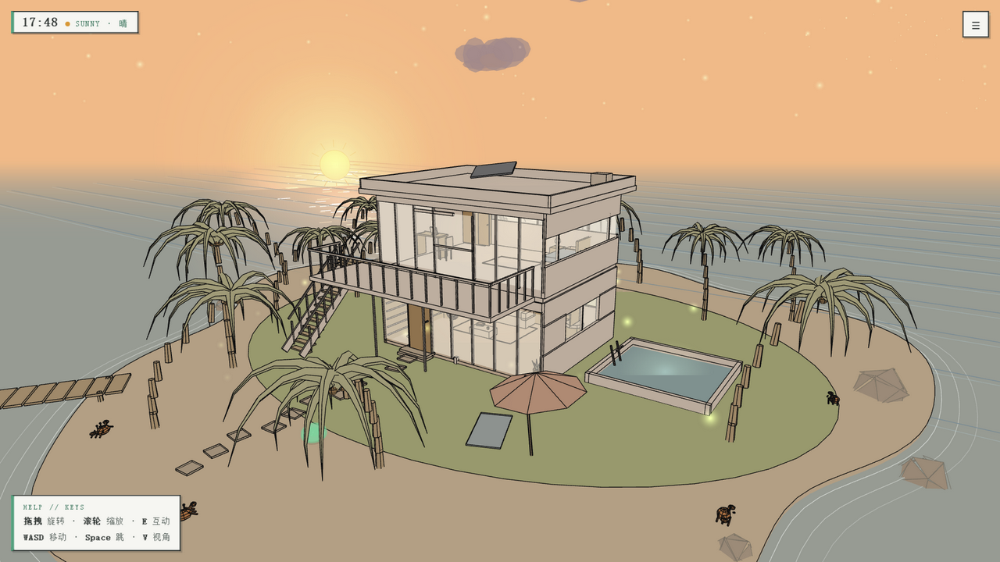
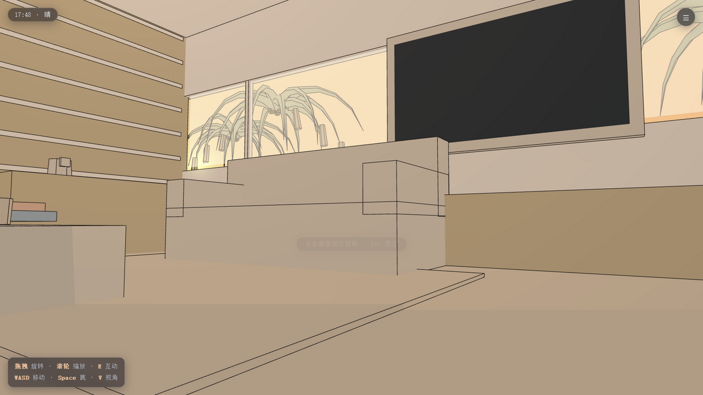
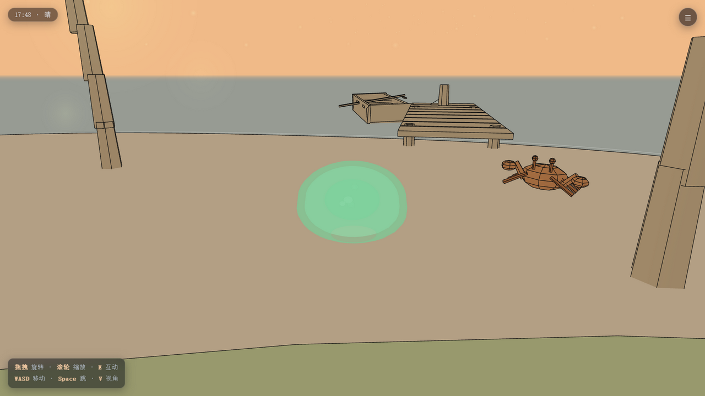
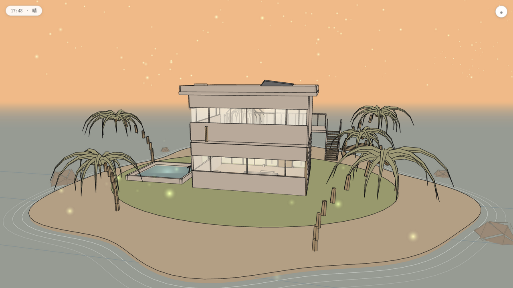
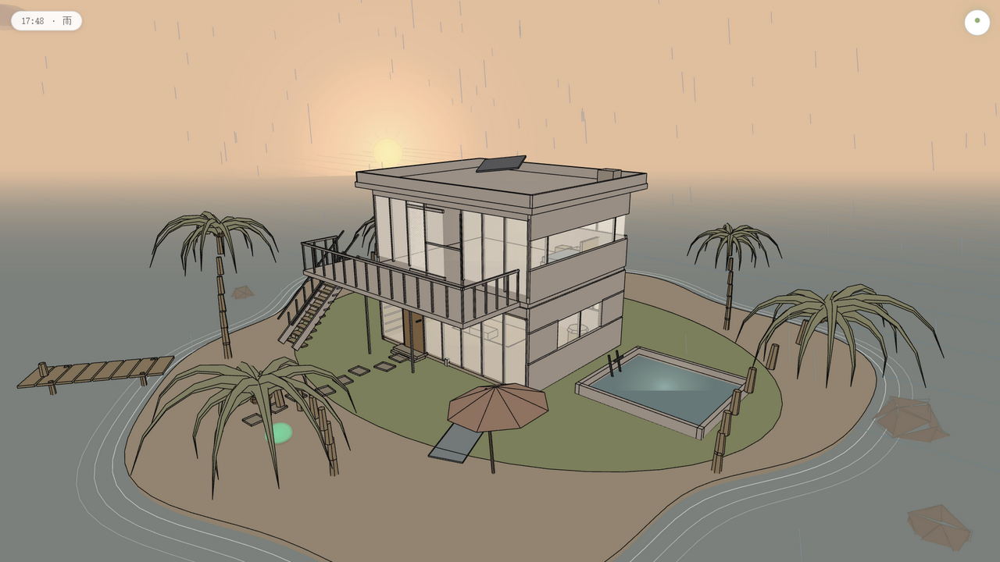

# 线稿风格海岛别墅 · Line-art Style Island Villa

一座手绘线稿风格的 3D 海岛：中央是一栋现代平顶二层别墅，四周环绕沙滩、棕榈、泳池与木栈桥码头。
时间永远定格在日落 17:48，天气系统完整保留——晴 / 多云 / 雾 / 雨 / 暴雨 / 雪 / 暴雪，随时切换。
沙滩上有会横着跑的小螃蟹，码头边拴着一条随波轻摇的小船，屋里每个角落都有可以按 E 玩一玩的家具。

> 线稿渲染技法、天空与天气系统移植自作者自己的开源项目
> [YIBI2333/line-art-style-magic-cabin](https://github.com/YIBI2333/line-art-style-magic-cabin)（MIT License）。











## ✨ 特性

- **线稿渲染**：白色纸面填充 + `EdgesGeometry` 黑色描边，山志画一样的手绘质感
- **日落定格**：天空渐变、太阳光晕、暮色萤火虫、室内暖光，全部锁定在 17:48 的黄昏
- **天气系统**：七种天气平滑过渡；雨雪粒子会落在屋顶 / 阳台 / 泳池水面；暴雨有闪电
- **昼夜天空**：星空 + 银河 + 流星（本页时间定格于日落，星空以暮色形式淡淡出现）
- **海岛生态**：会摇曳的棕榈树、礁石、木栈桥、遮阳伞、围着岛呼吸的浪花圈
- **现代别墅**：两层平顶别墅、玻璃幕墙、露台推拉门、外置悬挑楼梯、无边泳池（泳池灯可开关）
- **可交互家具**：电视（开关屏幕）、落地灯、床头灯（开关灯光）、衣柜（弹簧开门）、入户门 / 推拉门
- **海岛小生物**：沙滩螃蟹会横着爬、挥钳子，狮耶靠近还会受惊横跑
- **码头小船**：随波轻摇的划艇，缆绳拴在系船柱上
- **狮耶玩家**：Q 弹发条小人（用户提供的狮耶模型包，提取：天然有机鸡），可行走、跳跃、疾跑，按 E 与门 / 灯互动；GLB 加载失败时自动回退为线稿小海龟
- **三种视角**：全局固定视角（可旋转缩放）/ 第三人称 / 第一人称
- **莱茵生命风 UI**：纸白 + 莱茵绿 + 斜切角的技术文档风界面，RHINE LAB // 读数框时钟、实验报告式菜单分区、左下角 HELP//KEYS 按键卡
- **移动端适配**：虚拟摇杆 + 交互按钮

## 🎮 操作

| 场景 | 按键 |
| --- | --- |
| 固定视角 | 拖拽旋转 · 滚轮缩放 · 方向键旋转 · `+` / `−` 缩放 |
| 行走 | `WASD` / 方向键移动 · `Space` 跳跃 · `Shift` 疾跑 |
| 交互 | `E` 开门 / 推拉门 / 电视 / 落地灯 / 床头灯 / 衣柜 / 泳池灯 |
| 视角 | `V` 在第一 / 第三人称间切换（菜单可切固定视角） |

## 🚀 运行

页面是纯静态文件，本地起一个 HTTP 服务即可（直接双击 index.html 也可以运行）：

```bash
python -m http.server 8000
# 打开 http://localhost:8000
```

## 📦 部署到 GitHub Pages

1. 新建仓库，例如 `line-art-style-island-villa`
2. 把本目录全部文件推上去（`sounds/`、`three.min.js`、`js/`、`index.html` 都要）
3. 仓库 Settings → Pages → 选择 `main` 分支根目录
4. 访问 `https://<用户名>.github.io/line-art-style-island-villa/`

## 📁 目录结构

```
line-art-style-island-villa/
├── index.html        页面骨架 + 全部 UI 样式
├── three.min.js      Three.js r128（来自原作仓库）
├── models/           狮耶角色 GLB + 贴图
├── sounds/           音效（ui / toggle / door）
└── js/
    ├── materials.js  场景 / 渲染器 / 线稿材质(FILL+edge) / 音效系统
    ├── GLTFLoader.js three.js r128 官方 GLTF 加载器
    ├── sky.js        太阳 / 月亮 / 星空银河 / 流星
    ├── island.js     海水 / 沙滩 / 草坪 / 棕榈 / 礁石 / 码头 / 萤火虫
    ├── villa.js      二层别墅 / 泳池 / 阳台楼梯 / 弹簧门 / 碰撞与交互点
    ├── weather.js    七种天气粒子 + 日落定格的天空光照
    ├── player.js     史莱姆玩家 / 三视角 / 碰撞 / 功能键
    ├── ui.js         菜单 / 天气切换 / 音效设置
    └── main.js       主循环
```

## 🙏 致谢

- 原作与美术风格：[YIBI2333 / 线稿风格魔女小屋](https://github.com/YIBI2333/line-art-style-magic-cabin)
- 角色模型「狮耶」：来自用户提供的模型包（提取：天然有机鸡），仅用于个人展示
- [Three.js](https://threejs.org/)

## 📄 许可证

[MIT](./LICENSE) © YIBI2333
